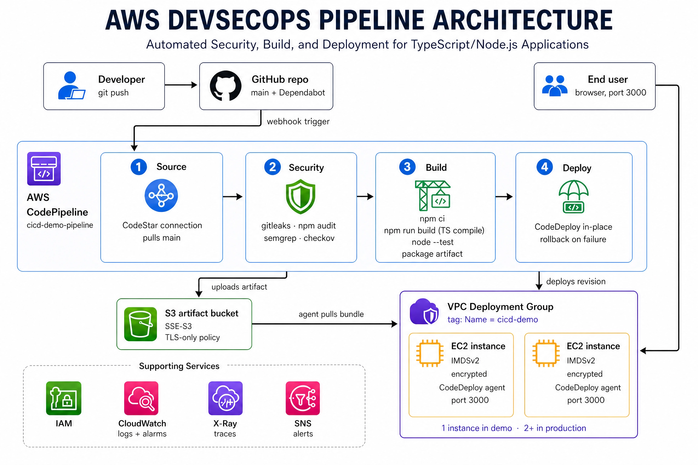

# AWS DevSecOps Pipeline with CodePipeline, CodeBuild, and CodeDeploy

A production-grade, fully automated DevSecOps pipeline on AWS. Every push to
this repository is pulled by **CodePipeline**, passed through **blocking
security gates** (secret scan, dependency audit, IaC scan), built and tested
by **CodeBuild**, and rolled out to hardened **EC2** instances by
**CodeDeploy**, with a health check gating the deployment and SNS alerts on
failure.



## Repository layout

```
.
├── appspec.yml                  # CodeDeploy deployment spec (hooks + file mapping)
├── buildspec.yml                # Build stage (install, audit gate, test, package)
├── buildspec-security.yml       # Security stage (gitleaks, npm audit, semgrep, checkov)
├── .pre-commit-config.yaml      # Same gates locally, before code ever pushes
├── .github/dependabot.yml       # Weekly dependency update PRs
├── app/                         # Deployment telemetry console (Node.js/Express)
│   ├── src/server.ts            # Entry point (listens on port 3000)
│   ├── src/app.ts               # /api/health, /api/telemetry, /api/info, /metrics
│   ├── src/app.test.ts          # Unit + HTTP tests (node --test on compiled output)
│   ├── tsconfig.json            # Strict TypeScript, compiled to dist/ in CodeBuild
│   └── public/index.html        # Live status frontend (uptime, figures, health strip)
├── ansible/provision.yml        # Config management: provision deploy targets (idempotent)
├── puppet/manifests/site.pp     # Same provisioning, Puppet flavour
├── platform/
│   ├── new-service.sh           # Golden-path scaffolder
│   └── verify_deploy.py         # Python post-deploy verification (health, metrics, stages)
├── infra/
│   └── pipeline.yml             # Complete CloudFormation stack (one-command setup)
├── scripts/                     # CodeDeploy lifecycle hooks
│   ├── stop_server.sh           # ApplicationStop
│   ├── before_install.sh        # BeforeInstall (Node 20 + pm2, clean deploy dir)
│   ├── install_dependencies.sh  # AfterInstall (npm ci --omit=dev)
│   ├── start_server.sh          # ApplicationStart (pm2)
│   └── validate_service.sh      # ValidateService (health check with retries)
├── setup/
│   ├── ec2-user-data.sh         # Installs the CodeDeploy agent at launch
│   └── iam/                     # IAM trust + artifact-access policies
└── docs/
    ├── architecture.svg         # Architecture diagram (demo topology)
    ├── system-design.md         # Production system design (requirements → estimates → deep dives)
    ├── system-design.excalidraw # Editable diagram (open at excalidraw.com)
    ├── threat-model.md          # Assets, trust boundaries, STRIDE table
    ├── slo.md                   # SLOs, error budget, alerting hooks
    ├── cost-estimate.md         # Monthly cost breakdown + controls
    ├── incident-postmortem-template.md
    └── runbooks/                # pipeline-failure.md, deployment-failure.md
```

## How the pipeline flows

1. Developer pushes to GitHub (`main` branch).
2. CodePipeline's **Source** stage detects the change through a CodeStar
   connection webhook and downloads the source into the artifact S3 bucket.
3. The **Security** stage runs `buildspec-security.yml`: gitleaks scans the
   whole tree for committed secrets, `npm audit` gates on high-severity
   vulnerabilities in production dependencies, and checkov statically analyses
   the CloudFormation templates. Any finding stops the pipeline before
   anything is built or deployed.
4. The **Build** stage runs `buildspec.yml` in CodeBuild: installs Node 20
   dependencies, re-runs the audit gate, runs the test suite, stamps
   `build-info.json` with the commit and build ID, and packages the deployment
   artifact (app + appspec + scripts).
5. The **Deploy** stage hands the artifact to CodeDeploy, whose agent on each
   EC2 instance runs the lifecycle hooks in order:
   `ApplicationStop → BeforeInstall → (file copy) → AfterInstall → ApplicationStart → ValidateService`.
   The app itself is started as the unprivileged `ec2-user`, never root.
6. `validate_service.sh` polls `http://127.0.0.1:3000/api/health`. If it never
   returns 200, the deployment is marked **Failed** and CodeDeploy redeploys
   the last known-good revision automatically.
7. Any pipeline failure publishes to an SNS topic via EventBridge (email
   subscription optional).

## DevSecOps controls

| Control | Tool | Where it runs | Blocking |
|---|---|---|---|
| Secret detection | gitleaks | pre-commit + Security stage | Yes |
| Dependency audit (SCA) | npm audit (high severity) | Security + Build stages | Yes |
| SAST | semgrep (auto ruleset) | Security stage | Yes |
| IaC static analysis | checkov | pre-commit + Security stage | Yes |
| Shift-left hygiene | pre-commit (private keys, YAML/JSON, no direct main commits) | Developer machine | Yes |
| Unit tests | node --test | Build stage | Yes |
| Post-deploy health gate | validate_service.sh + auto-rollback | Deploy stage | Yes |
| Dependency updates | Dependabot (weekly PRs) | GitHub | Advisory |
| Runtime HTTP hardening | helmet (CSP, HSTS, no sniff) + rate limiting | App | n/a |
| Least-privilege runtime | app runs as `ec2-user` via pm2 | EC2 | n/a |
| Instance hardening | IMDSv2 required, encrypted gp3 EBS | CloudFormation | n/a |
| Artifact security | SSE-S3, TLS-only bucket policy, public access blocked | CloudFormation | n/a |
| Least-privilege IAM | scoped role per service, no wildcards on resources | CloudFormation | n/a |
| Failure alerting | EventBridge → SNS (optional email) | CloudFormation | n/a |
| Instance monitoring | CloudWatch alarms (status checks, CPU) → SNS | CloudFormation | n/a |

**Operations pack** (in `docs/`): [system design](docs/system-design.md) ·
[threat model](docs/threat-model.md) ·
[SLOs + error budget](docs/slo.md) · [runbooks](docs/runbooks/) ·
[postmortem template](docs/incident-postmortem-template.md) ·
[cost estimate](docs/cost-estimate.md). Install the local gates once with
`pip install pre-commit && pre-commit install`.

## Observability (SRE)

All three pillars are wired end to end; details in [monitoring/README.md](monitoring/README.md):

| Pillar | How |
|---|---|
| **Metrics** | `prom-client` request histogram + process defaults at `GET /metrics`; system metrics via the CloudWatch agent |
| **Logs** | one structured JSON line per request, tailed by the CloudWatch agent into `/aws-cicd/app` (30-day retention), queryable in Logs Insights |
| **Traces** | X-Ray SDK Express middleware (`ENABLE_XRAY=true` in production) → X-Ray daemon on the instance → service map and per-request traces in the X-Ray console |

The status page is itself an SRE surface: it scores live SLIs against the
SLO targets (availability, p99 latency, error rate, error budget used),
shows the four golden signals (traffic, latency, errors, saturation via
event-loop lag), and tails its own access log — all computed in-process
from real requests and served at `GET /api/sli`.

Alerts: HTTP 5xx rate (metric filter on the logs), instance status checks,
sustained CPU, and pipeline failures, all publishing to one SNS topic.
Observability setup is a non-fatal deploy step: a broken agent degrades
visibility, never a release.

## Platform engineering

- `make help` is the paved road: test, audit, scan, validate, deploy, logs,
  pipeline status. Day-to-day work needs no raw aws-cli incantations.
- `platform/new-service.sh <name> <dest>` scaffolds a new service that
  inherits the whole golden path: pipeline gates, deploy hooks, monitoring,
  SLOs, and runbooks.
- `catalog-info.yaml` registers the service in a Backstage-style catalog.
- `platform/verify_deploy.py` (Python, stdlib only) proves a release end to
  end: stack outputs → health poll → metrics check → per-stage pipeline
  state. `make verify-deploy` after any release.

## Configuration management (Ansible / Puppet)

Instance *provisioning* is configuration management; per-deploy steps stay in
the CodeDeploy hooks. Three interchangeable ways to prepare a target host,
all producing the same baseline (CodeDeploy agent, CloudWatch agent, X-Ray
daemon, Node.js 20, pm2):

| Method | When to use |
|---|---|
| `setup/ec2-user-data.sh` or the CloudFormation user data | New instances at launch (default path) |
| `ansible/provision.yml` (`make provision`) | Existing instances or fleets, agentless over SSH, idempotent |
| `puppet/manifests/site.pp` (`puppet apply`) | Shops standardised on Puppet; same resources, declarative |

```bash
cp ansible/inventory.ini.example ansible/inventory.ini   # add your hosts
make provision
```

Language policy for this repo: application code is **TypeScript** (strict,
compiled in CodeBuild, only `dist/` runs in production), operational tooling
is **Python** (`platform/verify_deploy.py`), and shell is reserved for the
thin CodeDeploy lifecycle hooks where bash is the native interface.

Accepted risks (documented in `buildspec-security.yml`): the artifact bucket
skips access logging/versioning/replication checks because artifacts are
short-lived demo objects, and the t3.micro instance skips detailed-monitoring
and EBS-optimization checks. In a real production account, remove those
`--skip-check` entries and satisfy the controls instead.

---

## Two ways to provision

- **Option A (console, recommended for learning):** follow the step-by-step
  implementation below. This is what the project brief and screenshots expect.
- **Option B (infrastructure as code):** one CloudFormation stack provisions
  everything: artifact bucket, IAM roles, EC2 instance with the CodeDeploy
  agent, CodeBuild project, CodeDeploy application + deployment group, and the
  pipeline itself.

### Option B: deploy with CloudFormation

1. Push this repo to GitHub (see section 2 below).
2. Create the CodeStar connection once in the console (Developer Tools →
   Settings → Connections → Create connection → GitHub) and approve the GitHub
   app. This handshake cannot be automated. Copy the connection ARN.
3. Deploy the stack:
   ```bash
   aws cloudformation deploy \
     --template-file infra/pipeline.yml \
     --stack-name cicd-demo \
     --capabilities CAPABILITY_NAMED_IAM \
     --parameter-overrides \
       GitHubOwner=<your-github-username> \
       GitHubRepo=aws-cicd-pipeline \
       CodeStarConnectionArn=arn:aws:codestar-connections:...:connection/... \
       VpcId=vpc-xxxxxxxx \
       SubnetId=subnet-xxxxxxxx \
       SSHLocation=<your-ip>/32
   ```
4. The pipeline runs immediately. Get the app URL:
   ```bash
   aws cloudformation describe-stacks --stack-name cicd-demo \
     --query "Stacks[0].Outputs" --output table
   ```
5. Teardown: empty the artifact bucket, then
   `aws cloudformation delete-stack --stack-name cicd-demo`.

---

## Step-by-step implementation (Option A: console)

### 1. Infrastructure setup

#### 1.1 Provision EC2 instances

1. **IAM role for EC2** (Console → IAM → Roles → Create role):
   - Trusted entity: *AWS service → EC2* (see `setup/iam/ec2-trust-policy.json`).
   - Attach an inline policy from `setup/iam/ec2-artifact-access-policy.json`
     (replace `YOUR_ARTIFACT_BUCKET_NAME`), or attach the managed policy
     `AmazonS3ReadOnlyAccess` for simplicity.
   - Name it `ec2-codedeploy-role`.
2. **IAM role for CodeDeploy**: create a second role, trusted entity
   *CodeDeploy*, and attach the managed policy `AWSCodeDeployRole`.
   Name it `codedeploy-service-role`.
3. **Launch the instance** (EC2 → Launch instance):
   - AMI: **Amazon Linux 2023**, type: `t2.micro`/`t3.micro` (free tier).
   - IAM instance profile: `ec2-codedeploy-role`.
   - Security group inbound rules: SSH `22` (your IP), HTTP app port `3000`
     (`0.0.0.0/0` for testing).
   - **Tags: add `Name = cicd-demo`** — CodeDeploy targets instances by tag.
   - Advanced details → User data: paste `setup/ec2-user-data.sh`
     (edit the `REGION` variable if you are not in `us-east-1`).
4. **Verify the agent** after the instance boots:
   ```bash
   ssh ec2-user@<public-ip>
   sudo systemctl status codedeploy-agent   # should be "active (running)"
   ```

#### 1.2 Prepare S3 bucket (optional)

CodePipeline creates its own artifact bucket by default. To use your own:
create a bucket (e.g. `<your-name>-cicd-artifacts`), keep *Block all public
access* on, and reference it when creating the pipeline. Ensure the bucket
name matches the one in `ec2-artifact-access-policy.json`.

### 2. Source stage configuration

1. Push this repository to GitHub:
   ```bash
   git init && git add . && git commit -m "feat: initial CI/CD pipeline project"
   git branch -M main
   git remote add origin https://github.com/<you>/aws-cicd-pipeline.git
   git push -u origin main
   ```
2. In CodePipeline you will connect GitHub via a **CodeStar connection**
   (Developer Tools → Settings → Connections → Create connection → GitHub →
   Install the AWS Connector app on your repo). This replaces legacy OAuth
   webhooks and gives automatic triggers on push.

### 3. Build stage with AWS CodeBuild

1. Console → CodeBuild → Create project:
   - Name: `cicd-demo-build`.
   - Source: GitHub (via the same connection), repo `aws-cicd-pipeline`.
   - Environment: **Managed image → Amazon Linux → Standard → latest**,
     new service role.
   - Buildspec: *Use a buildspec file* (it reads `buildspec.yml` at repo root).
2. What `buildspec.yml` does:
   - `install`: Node.js 20 runtime, `npm ci`.
   - `pre_build`: runs the test suite (`node --test`). A failing test fails
     the build, which halts the pipeline before anything is deployed.
   - `build`: writes `app/public/build-info.json` (commit SHA, build ID,
     timestamp) so the deployed page can prove which build it came from.
   - `artifacts`: packages `appspec.yml`, `scripts/`, and `app/` while
     excluding `node_modules` (dependencies are installed on the instance).
3. **Create a second CodeBuild project for the security gates:**
   - Name: `cicd-demo-security`, same environment as above.
   - Buildspec: *Use a buildspec file* → `buildspec-security.yml`.
   - This project runs gitleaks (secrets), npm audit (dependencies), and
     checkov (IaC) — each one blocking.
4. *(Optional)* For separate frontend/backend builds, add a second buildspec
   and run the actions in parallel within the same Build stage.

### 4. Deploy stage with AWS CodeDeploy

1. Console → CodeDeploy → Applications → Create application:
   - Name: `cicd-demo-app`, compute platform: **EC2/On-premises**.
2. Create a **deployment group**:
   - Name: `cicd-demo-group`, service role: `codedeploy-service-role`.
   - Deployment type: **In-place** (blue/green also works if you front the
     instances with a load balancer).
   - Environment configuration: **Amazon EC2 instances**, tag key `Name`,
     value `cicd-demo`.
   - Deployment settings: `CodeDeployDefault.AllAtOnce` (use `OneAtATime`
     for rolling updates across multiple instances).
   - Load balancer: disable (unless doing blue/green).
   - Rollbacks: enable *Roll back when a deployment fails*.
3. `appspec.yml` copies the artifact to `/var/www/aws-cicd-app`, marks the
   scripts executable, and wires the lifecycle hooks listed above.

### 5. AWS CodePipeline setup

1. Console → CodePipeline → Create pipeline:
   - Name: `cicd-demo-pipeline`, new service role, default (or custom)
     artifact bucket.
   - **Source stage**: GitHub (via CodeStar connection) → repo
     `aws-cicd-pipeline` → branch `main`. Leave *trigger on push* enabled.
   - **Build stage**: AWS CodeBuild → `cicd-demo-build`.
   - **Deploy stage**: AWS CodeDeploy → application `cicd-demo-app` →
     deployment group `cicd-demo-group`.
2. After creation, **Edit** the pipeline and add a **Security** stage between
   Source and Build: action provider *AWS CodeBuild*, project
   `cicd-demo-security`, input artifact `SourceArtifact`. (The CloudFormation
   template in `infra/` creates this stage automatically.)
3. Save. The pipeline immediately runs end to end with the current `main` —
   watch Source → Security → Build → Deploy each turn green.

### 6. Testing and validation

1. **Push a change** and watch it ship with zero manual steps:
   ```bash
   # e.g. edit the headline in app/public/index.html
   git commit -am "feat: update headline"
   git push
   ```
2. **Monitor execution**: CodePipeline console shows the stages progressing;
   CodeBuild → Build history has the full build/test logs; CodeDeploy →
   Deployments shows every lifecycle hook with per-event logs.
3. **Validate the app**: open `http://<ec2-public-ip>:3000` in a browser.
   The page displays the commit SHA and build ID it was deployed from, so you
   can confirm the new version is live. On the instance itself:
   ```bash
   curl -s http://127.0.0.1:3000/api/health   # {"status":"ok",...}
   pm2 status                                  # aws-cicd-app online
   sudo tail -f /var/log/aws/codedeploy-agent/codedeploy-agent.log
   ```

### 7. Troubleshooting

| Symptom | Likely cause / fix |
|---|---|
| Deploy stage stuck then fails with no events | CodeDeploy agent not running: `sudo systemctl restart codedeploy-agent` |
| `AccessDenied` downloading bundle | EC2 role missing S3 read on the artifact bucket |
| `ApplicationStop` fails on redeploy | A previous broken revision's script is cached; fix via `sudo rm -rf /opt/codedeploy-agent/deployment-root/*` and redeploy |
| Build fails on `npm ci` | Commit `app/package-lock.json` (run `npm install` locally once) |
| Health check fails | `pm2 logs aws-cicd-app` on the instance; check port 3000 not blocked |
| Pipeline doesn't trigger on push | CodeStar connection still *Pending*: complete the GitHub app installation |

### 8. Submission checklist (screenshots)

- [ ] EC2 instance running with the `Name=cicd-demo` tag and IAM role attached
- [ ] `systemctl status codedeploy-agent` showing *active (running)*
- [ ] CodeStar connection in *Available* state
- [ ] CodeBuild project build history with a successful build and test logs
- [ ] Security stage logs showing gitleaks, npm audit, and checkov all passing
- [ ] CodeDeploy deployment showing all lifecycle events succeeded
- [ ] CodePipeline with Source, Security, Build, Deploy all green
- [ ] The app in a browser at `http://<ec2-ip>:3000` showing the commit/build ID
- [ ] A second pipeline run triggered automatically by a new `git push`

## Run locally

```bash
cd app
npm install
npm test           # compiles TypeScript, then runs the suite
npm start          # builds and serves http://localhost:3000
```
