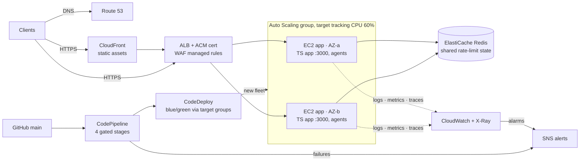

# System design: deploy-record service, demo to production

**Status:** target design · **Last reviewed:** 2026-07-13
**Editable diagram:** open [`system-design.excalidraw`](system-design.excalidraw) at [excalidraw.com](https://excalidraw.com) (File → Open).

The demo topology (one t3.micro, public port 3000) is deliberately minimal.
This document designs the same service as it would run in production, using
the interview-style structure: requirements → estimates → high-level design →
deep dives → failure modes.

## 1. Requirements

**Functional**
- Serve the status page and JSON APIs (`/api/health`, `/api/telemetry`, `/api/info`).
- Expose `/metrics` to an internal scraper only.
- Every merge to `main` reaches production automatically through the gated pipeline.

**Non-functional**
- Availability 99.9% (SLO in [slo.md](slo.md); the demo's 99.5% reflects its single instance).
- p99 latency < 300 ms.
- Zero-downtime deploys; a bad release rolls back automatically.
- HTTPS only; instances never directly reachable from the internet.

## 2. Back-of-envelope estimates

Assumptions are labeled; replace with real numbers when they exist.

| Quantity | Estimate | Working |
|---|---|---|
| Daily active users (assumed) | 10,000 | portfolio-scale service |
| Requests/user/day | ~50 | page load + 3s/5s polling for a couple of minutes |
| Average RPS | ~6 | 500k req / 86,400 s |
| Peak RPS (10x average) | ~60 | traffic is bursty around deploys |
| Response size | ~2 KB JSON, ~30 KB first page load | measured locally |
| Peak bandwidth | ~1 MB/s | 60 rps × ~16 KB weighted average |
| Instance capacity (t3.small, measured locally ~4 ms/req) | ~500 rps CPU-bound ceiling; plan for 150 rps/instance at 30% headroom | |
| Fleet size | **2 instances minimum** (one per AZ), scale to 4 | availability drives the number, not load |

Conclusion: this service is availability-bound, not throughput-bound. The
design work goes into redundancy and safe delivery, not sharding.

## 3. Target architecture

### Component responsibilities

| Component | Job | Why it exists |
|---|---|---|
| Route 53 | DNS, health-checked alias to the ALB | stable name, failover-ready |
| CloudFront | caches `public/` static assets at the edge | cuts instance load and first-paint latency |
| ALB + ACM | TLS termination, HTTP→HTTPS redirect, health checks on `/api/health` | instances leave the public internet entirely |
| WAF (managed rules) | common exploit and bot filtering at the edge | cheap defense in depth in front of helmet |
| Auto Scaling group | 2 instances across 2 AZs, target tracking on CPU 60% | survives an AZ loss; absorbs bursts |
| ElastiCache Redis | shared store for `express-rate-limit` | in-memory limits break behind a load balancer (each instance would count separately) |
| CodeDeploy blue/green | provisions the green fleet, shifts the target group, keeps blue for instant rollback | zero-downtime, one-click (or automatic) rollback |
| CloudWatch + X-Ray + SNS | unchanged from the demo | observability plane already built |

## 4. Deep dives

### Delivery: in-place → blue/green
The pipeline stays identical (Source → Security → Build → Deploy); only the
deployment group changes. CodeDeploy launches a green copy of the fleet,
runs the same lifecycle hooks and `ValidateService` health gate on it, then
rewires the ALB target group. Blue stays warm for the rollback window. The
`appspec.yml` and `scripts/` need zero changes: that is the payoff of putting
the health gate in the hooks rather than in the pipeline.

### State: keeping the app stateless
The app has exactly one piece of cross-request state: rate-limit counters.
In a fleet, in-memory counters undercount by a factor of N instances, so the
limiter gets a Redis store (`rate-limit-redis` + ElastiCache). Everything
else (build info, telemetry) is per-instance by design; no database is
needed until a real product feature demands one — at which point RDS
Multi-AZ slots in behind the fleet without touching the edge.

### Health checks, layered
- **ALB** checks `/api/health` every 10 s and ejects a failing instance from rotation (seconds).
- **CodeDeploy** gates each deployment on the same endpoint via `validate_service.sh` (per release).
- **CloudWatch alarms** on 5xx rate, status checks, CPU (minutes, pages a human).

Same endpoint, three consumers, three time horizons.

### Security deltas from the demo
- Instance security group: inbound only from the ALB security group; SSH removed in favour of SSM Session Manager (role already attached).
- `/metrics` moves behind an ALB listener rule that only matches an internal path header, or is scraped over the private network.
- The threat-model accepted risks for HTTP and public `/metrics` are retired.

## 5. Failure modes

| Failure | Blast radius | Handled by |
|---|---|---|
| One AZ down | half the fleet | ALB ejects targets; ASG rebuilds in the healthy AZ |
| Bad release | green fleet only | ValidateService fails → traffic never shifts → auto rollback |
| Redis down | rate limiting only | limiter fails open (allow) and logs; app stays up |
| Pipeline down | deploys blocked, prod unaffected | pipeline-failure runbook; manual deploy from last artifact if critical |
| Traffic spike | latency | ASG target tracking; CloudFront absorbs static load |
| Cert expiry | none | ACM auto-renews |

## 6. What changes in the IaC

Delta to `infra/pipeline.yml` (kept as a documented target, not built in the demo):

1. `AWS::ElasticLoadBalancingV2::LoadBalancer` + listener (443, ACM cert) + target group; SG chain `ALB-SG → App-SG`.
2. Replace `AWS::EC2::Instance` with `LaunchTemplate` + `AutoScalingGroup` (2 AZs, the same user data and instance profile).
3. `DeploymentGroup`: `DeploymentStyle` → `BLUE_GREEN` / `WITH_TRAFFIC_CONTROL`, `LoadBalancerInfo` → the target group.
4. `AWS::ElastiCache::ServerlessCache` (or a t4g.micro replication group) + app env `REDIS_URL`.
5. Route 53 alias record + ACM certificate; optional CloudFront distribution in front.

Cost delta: roughly +$16/month ALB, +$8 second instance, +$6 ElastiCache
serverless floor — production posture for ~$30/month over the demo
([cost-estimate.md](cost-estimate.md) has the demo baseline).
